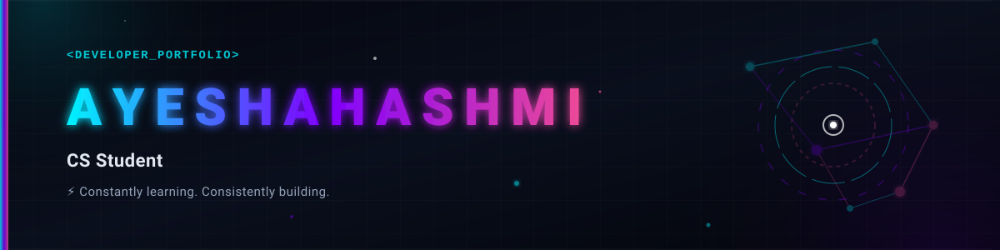

  <!-- Dynamic Custom Header Banner -->
  

  <!-- Animated Typing Widget -->
  

  <strong>CS Student • Software Developer</strong> 
  <em>A computer science student focused on engineered problem-solving, building high-performance systems, and translating complex concepts into clean, functional code.</em>

---

## 🌌 About Me

I am a Computer Science student and Software Developer passionate about full-stack development, modern web and mobile frameworks, and cloud architecture. My focus spans from core backend engineering with **.NET, Node.js, and SQL Server** to crafting intuitive interfaces using **React, Bootstrap, Framework7, and Figma**. 

I believe in clean architectures, efficient code, and continuous learning across system networking, containerization with **Docker**, and modern UI/UX design.

---

## 🛠️ Tech Stack

  
  
  
  
  
  

  
  
  
  
  

  
  
  
  
  
  

---

## ⚡ Current Status

* 🚀 **Current Focus**: Building scalable full-stack applications with modern web & mobile frameworks.
* 📚 **Currently Learning**: Containerization with Docker, advanced network configurations, and microservices architecture.
* 🤝 **Collaboration Interests**: Open-source projects, full-stack web platforms, and UI/UX design integrations.
* 💬 **Ask me about**: Web development, C#/.NET architecture, UI design in Figma, and database configurations.
* 📬 **Get in touch**: Connect with me on GitHub or LinkedIn!

---

## 📊 GitHub Analytics

  <!-- Main Stats Card -->
  

  <!-- Top Languages Card -->
  
  &nbsp;&nbsp;
  <!-- Contribution Streak Card -->
  

  <!-- Dynamic Contribution Activity Graph SVG -->
  

---

## 🤝 Connect With Me

  
  

---

  Developed with 💜 by <b>Ayesha Tahira Hashmi</b>

